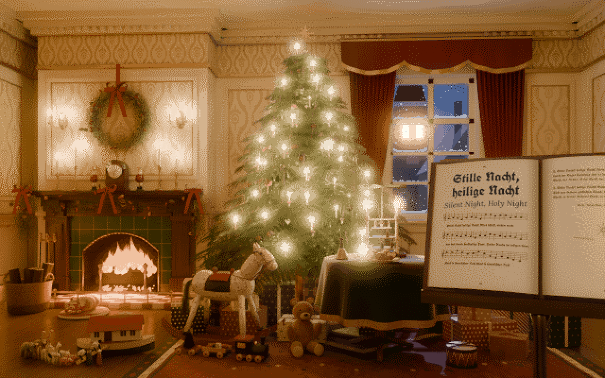
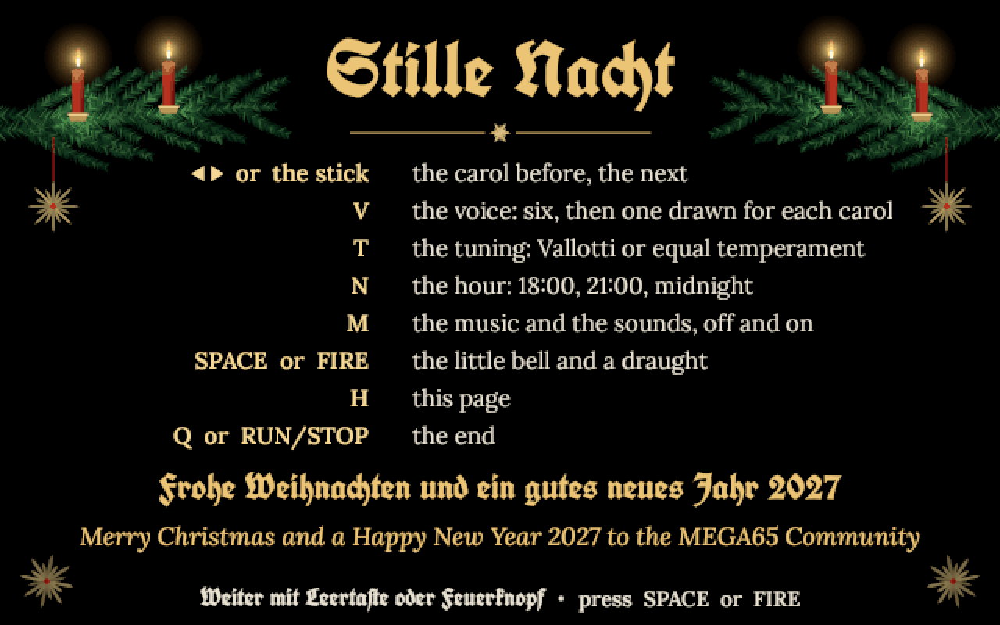
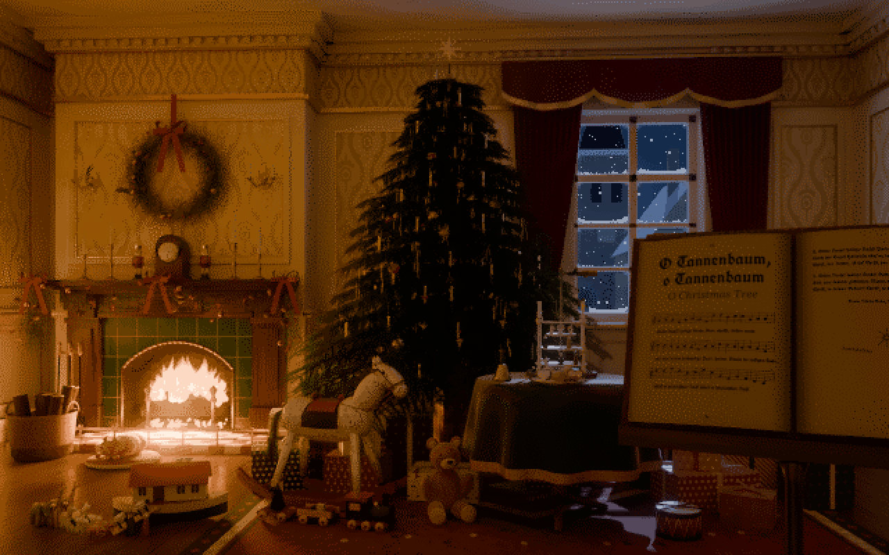
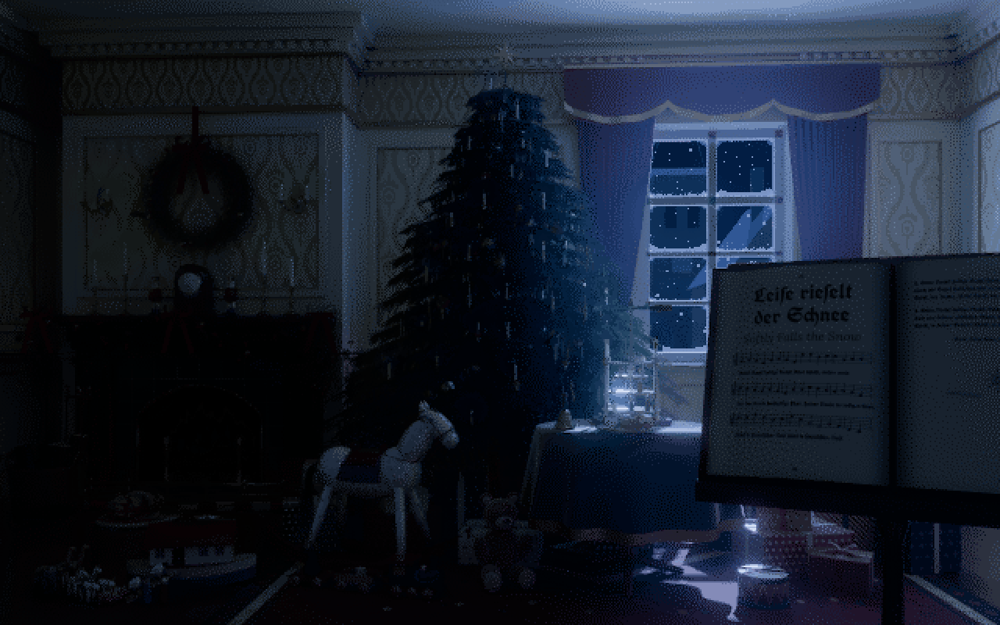

# Stille Nacht

A parlour of the 19th century on Christmas Eve: the tree lit with wax candles, the fire, snow falling
past the window, and 25 old German carols on the four SIDs. For the MEGA65.

Through the window, across the snowy square, the church's belfry is lit. N takes the evening on: at
18:00 everything burns; at 21:00 the candles are out and the fire alone lights the room; at midnight
the fire is out too, and the moon and the falling snow are left. The carols play in a round, each
twice, in the voice you choose, from the Black Forest's flute clock to the brass choir in the tower,
tuned in Vallotti's temperament. SPACE rings the little bell and sends a draught through the flames.

Merry Christmas and a Happy New Year 2027 to the MEGA65 Community.
Frohe Weihnachten und ein gutes neues Jahr 2027.

Version 1.0, 21 November 2026.

A 79-second video, with sound: [docs/stille-nacht.mp4](docs/stille-nacht.mp4). The landing page while
the files load; the opening: the little bell, the candles catching one by one, Stille Nacht; the bell
and a draught; 21:00, the fire flaring; midnight; 18:00 again, and the next carol in the brass choir.

## Run

Needs a MEGA65 with its attic RAM (the program checks), in PAL (50 Hz): the music, the lights and the
snow are timed by the frame, and NTSC has not been tried.

1. Download `STILLENACHT.D81` from the [latest release](https://github.com/psincosoft/stille-nacht/releases/latest)
   and copy it to the SD card.
2. `MOUNT "STILLENACHT.D81"`
3. `LOAD"*",8,1`, then `RUN`

The disk's SHA-256: `d80ef52f35875fb1fcb9052afe03f5eb7f0e6d593dcdcd4a828a1f20163102b5`.

The opening card, then the landing page with the keys and the season's wishes; its four candles light
one by one as the files load beneath it. When all four burn, any key or FIRE begins the piece. While it
runs it borrows the memory of the ROM's copy (the hypervisor lifts its protection) and puts everything
back when it ends; if the hypervisor does not lend it, the program says so and ends.

## Keys

| Key | What it does |
|---|---|
| SPACE or FIRE | the little bell, and a draught through the flames |
| CRSR left and right, or the stick | the carol before, the next |
| V | the voice: Stubenmusik (at the start), flute clock, barrel organ, harmonium, brass choir, church organ, then Random (a voice drawn for each carol); the songbook names it |
| T | the tuning: Vallotti's temperament (at the start) or equal temperament; the songbook names it |
| N | the hour: 18:00, 21:00, midnight |
| M | the music and the sounds: all on; the sounds off; the music off; both off |
| H | the landing page again, everything paused; any key or FIRE: back |
| C | the CPU meter: the border lit while the engine works on a frame |
| Q or RUN/STOP | the end: BASIC's screen as it was |

The joystick works in either port.

## What is in it

- **The parlour.** Christmas Eve as a child remembers it: the spruce hung with candles in tin clips,
  glass baubles, straw stars and glass fly agarics; the presents and toys beneath it, Noah's ark from
  the Erzgebirge on the floor; the fireplace with its garland and wreath; the Erzgebirge pyramid on
  the round table; through the window the town in the snow and the church tower. The scene is built
  in code and rendered with Blender, then shown on the 80 x 50 text screen in full-colour characters:
  640 x 400 pixels, one picture under three palettes, one for each hour.
- **What moves.** Every candle's light rises and falls on its own; the fire's flames dance; the
  belfry's lantern flickers. Snow falls in the wind, a gust now and then, and lies on the window's bars
  until a gust takes it. The opening: the room lit by the fire alone, a little bell, the candles
  catching one by one, then the first carol.
- **The music.** 25 carols, each twice, three seconds apart, the fire heard alone between them. The
  engine computes each voice from the carol's notes, on the four SIDs: the Stubenmusik (zither,
  dulcimer, guitar), the flute clock, the market's barrel organ, the harmonium in the parlour, the
  brass choir from the tower, the church's organ across the square. Vallotti's temperament gives every
  key its own colour, with A at 440 Hz; T changes to equal temperament. The carols and their sources:
  [CAROLS.md](CAROLS.md).
- **The sounds.** The fire's flame, hiss and cracks, and the little bell, on the sample channels:
  computed, not recorded. The bell rings the fifth of the carol's key, in the tuning in use.
- **The songbook.** The carol's title on its open page, the German in Fraktur, the English beneath.

## Pictures

The pictures and the video are made on a PC from a model of the program that its engine matches every
frame; the sound is the same writes to the SIDs and the sample channels, played through a port of the
MEGA65 core's SIDs and mixed as the core mixes them. They are not recordings of the machine.

## Tested on

A MEGA65 (R6A) in PAL, core 890-sdcard-native build #63 (commit 1c737937), ROM 920422.

## Credits

Stille Nacht 1.0, 2026, by Dawid Blachowski, with Claude, Anthropic's AI.
psinco. A Software Atelier from Luxembourg.

- Written with Claude, Anthropic's AI, which wrote the code, built the scene, arranged the carols for
  the six voices, set 18 of them in four parts, made the fire's sound and the bell, and drew the
  landing page, under Dawid Blachowski's direction.
- The scene rendered with Blender.
- The tuning: Vallotti's temperament, chosen by Dawid Blachowski by ear on the MEGA65.
- The carols: music whose makers died before 1926, published before 1931; the words not used. The
  melodies read from Musikpiraten e.V.'s songbook *Singen im Advent* (its LilyPond files, given to the
  public domain), from Benjamin Bloomfield's collection of Christmas carols (LilyPond, given by its
  maker to the public domain) and from the scores in de.wikipedia's articles and de.wikibooks'
  *Liederbuch*, each checked against a second source. Seven carols play in four-part settings from
  Bloomfield's collection, the other 18 in settings of ours. Each carol and its sources:
  [CAROLS.md](CAROLS.md).
- The type: UnifrakturCook (j. 'mach' wust, after Peter Wiegel) for the German, Lora (the Lora Project
  Authors) for the English; both under the SIL Open Font License 1.1.
- Made with Python, NumPy, SciPy, Pillow, OpenEXR, LilyPond, LZ4, py65 and PyPy; tested in Xemu; the
  video with FFmpeg.

## Terms

Stille Nacht is free, under the MIT licence: see [LICENSE](LICENSE). Its source code is not published.
